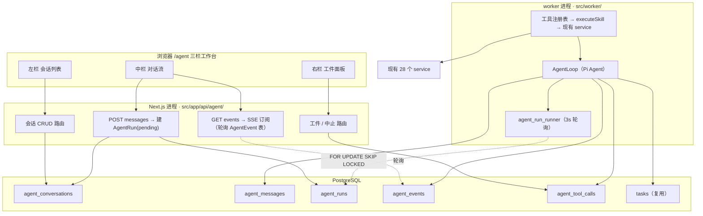

# 自主 Agent 工作台 —— 设计文档

- 文档日期：2026-10-09
- 状态：待评审
- 目标读者：xhs-assistant 开发者

---

## 1. 背景与目标

### 1.1 背景

xhs-assistant 当前已是具备完整运营能力的平台：148 个 REST 路由、37 个 Prisma 模型、28 个 service、6 个 worker 调度任务。但所有能力都是**表单驱动**的——用户需要在「策划工作台」「草稿工坊」「图片工坊」等页面之间切换，手工填参数、手工串联流程。

现有 `workflow-service.ts` 提供了工作流编排能力，但它是**预置的线性步骤**（`nodes: [{id, skillKey, params, next}]`），无法处理开放式需求，也不支持对话。

### 1.2 目标

新增一个自主 Agent 工作台模块，实现：

1. **工作台模式**：三栏界面（会话列表 + 对话流 + 工件面板），多任务并行、互不干扰
2. **自然语言驱动**：用户一句话描述需求，Agent 自主规划、调用工具、交付成果
3. **现有能力工具化**：把项目已有的内容生产、数据检索能力包装成 Agent 可调用的工具

### 1.3 参照对象

- **WorkBuddy**（腾讯云 CodeBuddy 团队）：桌面级 AI Agent 工作台，"你说我做"，自然语言 → 自主规划 → 调工具 → 交付可验收成果
- **Pi Agent SDK**（earendil-works/pi）：TypeScript 开源 Agent 运行时，提供 Agent Loop、工具系统、事件流

---

## 2. 决策记录

以下决策均已经过讨论确认：

| # | 决策点 | 结论 | 理由 |
|---|---|---|---|
| D1 | Agent 自主度 | **完全自驱 ReAct 循环** | 用户明确选择能力最强档 |
| D2 | 工作台形态 | **三栏：会话 + 对话 + 工件** | 产物有集中展示位，最接近 WorkBuddy 体验 |
| D3 | 首期工具范围 | **内容生产链路 + 数据检索与洞察** | 排除发布类（风险）、账号抓取类（Agent 用不到） |
| D4 | 循环执行位置 | **后台 worker 执行 + SSE 订阅** | 请求断连不丢任务，可重连可回放 |
| D5 | 工具暴露方式 | **进程内函数注册表** | 零 HTTP 开销、类型安全、可跨步骤事务 |
| D6 | 导航入口 | **新增一级入口 `/agent`** | Agent 是跨模块总入口，不埋在 xhs 平台下 |
| D7 | 写操作护栏 | **分级：write 可自跑，publish 需确认** | 首期不含 publish 工具，从源头杜绝误发布 |
| D8 | Agent 运行时 | **直接使用 Pi Agent SDK** | 循环、工具系统、事件流、护栏钩子全部现成 |
| D9 | 工具调用协议 | **原生 tool calling** | 推翻早前的"文本协议"方案，与 Pi 保持一致 |
| D10 | 工具 schema | **重建为 TypeBox schema** | Pi 用 TypeBox 校验入参，裸 JSON Schema 不可直接强转 |
| D11 | 模式支持 | **仅默认模式 + 轻量预告** | 不做 Plan/Ask 模式；Pi 的原生 tool calling 天然先输出文字预告 |
| D12 | 上下文预算 | **字符数估算（chars/2）** | 不引 tokenizer 依赖，中文场景够用 |
| D13 | 接口命名风格 | **沿用 snake_case** | 与现有 148 个路由保持一致；仅 TS 变量/函数用驼峰 |
| D14 | 同会话并发 | **Pi 的 `followUp()` 排队语义** | 执行中再发消息则排队，优于 409 拒绝 |
| D15 | worker 唤醒 | **3 秒轮询** | Agent 任务本身耗时 30s+，3s 延迟可忽略，不引入 NOTIFY |
| D16 | docs 目录 | **本次建立** | `docs/` 作为总代码文档落点，本设计文档放 `docs/superpowers/specs/` |

---

## 3. 依赖核实结论

以下结论**基于对 npm 包内 `.d.ts` 类型定义的实际读取**，非文档推测。

### 3.1 包名与版本

命名空间已从个人账号迁移到组织账号：

| 包 | 版本 | 仓库 | 状态 |
|---|---|---|---|
| `@mariozechner/pi-*` | 0.73.1 | `github.com/badlogic/pi-mono` | 旧，个人命名空间 |
| `@earendil-works/pi-*` | **1.1.0** | `github.com/earendil-works/pi` | **新，采用此版本** |

版本演进：`0.84.x → 0.87.1 → 0.99.2 → 1.0.0 → 1.1.0`（迭代活跃）

### 3.2 采用的两个包

```
@earendil-works/pi-agent-core@1.1.0   ← Agent 运行时（tarball 61KB）
@earendil-works/pi-ai@1.1.0           ← 传输层 + provider 适配（tarball 791KB）
```

- `engines: { node: ">=22.19.0" }` —— 项目 Node 24.17.0 ✅
- 两者均为 `"type": "module"`（ESM-only，无 CJS 入口）
- `pi-agent-core` 依赖：`typebox@1.3.27`、`@earendil-works/pi-ai@^1.1.0`
- `pi-ai` 依赖：`openai@7.19.0`、`@anthropic-ai/sdk@0.129.0`、`@google/genai@2.21.0`、`@aws-sdk/client-bedrock-runtime@3.1127.0`、`@smithy/node-http-handler`、`http-proxy-agent`、`https-proxy-agent`、`partial-json`、`typebox`、`@earendil-works/pi-telemetry`
- `npm install --dry-run` 实测：**新增 78 个包**

### 3.3 关键 API（已核实）

**`Agent` 类**（`pi-agent-core/dist/agent.d.ts`）：

```ts
class Agent {
  constructor(options: AgentOptions);
  subscribe(listener: (event: AgentEvent, signal: AbortSignal) => Promise<void> | void): () => void;
  get state(): AgentState;              // systemPrompt / model / thinkingLevel / tools / messages / isStreaming / streamingMessage / pendingToolCalls / errorMessage
  steer(message: AgentMessage): void;   // 当前 assistant turn 结束后注入
  followUp(message: AgentMessage): void; // Agent 本该停止时才执行
  clearSteeringQueue(): void;
  clearFollowUpQueue(): void;
  clearAllQueues(): void;
  hasQueuedMessages(): boolean;
  peekQueuedMessages(): AgentMessage[];
  get signal(): AbortSignal | undefined;
  abort(): void;
  waitForIdle(): Promise<void>;
  reset(): void;
  prompt(message: AgentMessage | AgentMessage[]): Promise<void>;
  prompt(input: string, images?: ImageContent[]): Promise<void>;
  continue(): Promise<void>;            // 续跑，末条须为 user 或 tool-result
}
```

**`AgentOptions`**（全部可用钩子）：

```ts
interface AgentOptions {
  initialState?: AgentInitialState;      // systemPrompt / tools / messages / model / thinkingLevel
  convertToLlm?: (messages: AgentMessage[]) => Message[] | Promise<Message[]>;
  transformContext?: (messages: AgentMessage[], signal?: AbortSignal) => Promise<AgentMessage[]>;
  streamFn: StreamFn;                    // 【必需】LLM 传输层
  getApiKey?: (provider: string) => Promise<string | undefined> | string | undefined;
  onPayload?; onResponse?; onProviderStreamEvent?;
  beforeToolCall?: (context: BeforeToolCallContext, signal?: AbortSignal)
      => Promise<BeforeToolCallResult | undefined>;   // 返回 { block: true, reason } 阻断执行
  afterToolCall?: (context: AfterToolCallContext, signal?: AbortSignal)
      => Promise<AfterToolCallResult | undefined>;    // 可替换 content / details / isError
  finishTurn?: FinishTurn;               // 返回 { action: "end" } 可提前结束
  prepareRequest?: PrepareRequest;
  prepareNextTurn?: (...) => ...;
  prepareNextTurnWithContext?: (...) => ...;
  steeringMode?: QueueMode;              // "all" | "one-at-a-time"
  followUpMode?: QueueMode;
  sessionId?: string;
  thinkingBudgets?: ThinkingBudgets;
  transport?: Transport;
  maxRetryDelayMs?: number;
  toolExecution?: ToolExecutionMode;     // "sequential" | "parallel"（默认 parallel）
}
```

**`AgentEvent` 联合类型**（10 种，这是 `AgentEvent` 表的直接数据源）：

```ts
type AgentEvent =
  | { type: "agent_start" }
  | { type: "agent_end"; messages: AgentMessage[] }
  | { type: "turn_start" }
  | { type: "turn_end"; message: AgentMessage; toolResults: ToolResultMessage[] }
  | { type: "message_start"; message: AgentMessage }
  | { type: "message_update"; message: AgentMessage; assistantMessageEvent: AssistantMessageEvent }
  | { type: "message_end"; message: AgentMessage }
  | { type: "tool_execution_start"; toolCallId: string; toolName: string; args: any }
  | { type: "tool_execution_update"; toolCallId: string; toolName: string; args: any; partialResult: any }
  | { type: "tool_execution_end"; toolCallId: string; toolName: string; result: any;
      isError: boolean; durationMs?: number };   // durationMs 由 Pi 提供（单调时钟）
```

**`AgentTool` 接口**（工具定义）：

```ts
interface AgentTool<TParameters extends TSchema = TSchema, TDetails = any> extends Tool<TParameters> {
  label: string;                          // UI 显示名
  prepareArguments?: (args: unknown) => Static<TParameters>;  // 原始参数兼容垫片
  outputSchema?: TSchema;                 // structuredContent 的 JSON Schema
  execute: (toolCallId: string, params: Static<TParameters>, signal?: AbortSignal,
            onUpdate?: AgentToolUpdateCallback<TDetails>) => Promise<AgentToolResult<TDetails>>;
  replay?: "never" | "safe";              // 副作用恢复策略
  executionMode?: ToolExecutionMode;      // 单工具覆盖
}

interface AgentToolResult<T> {
  content: (TextContent | ImageContent)[]; // 模型可见内容
  details: T;                              // UI / 日志用
  structuredContent?: JsonValue;           // 程序化调用用，不发给模型
  usage?: Usage;
  isError?: boolean;                       // 报错不抛异常
  terminate?: boolean;                     // 整批工具结束时提前终止
}
```

**`Model` 接口**（可字面量构造，无需注册 provider）：

```ts
interface BaseModel<TApi extends string> {
  id: string; name: string; api: TApi; provider: ProviderId;
  baseUrl: string; input: ("text" | "image")[];
  inputLimits?: ModelInputLimits; cost: ModelCost;
  headers?: Record<string, string>;
}
interface Model<TApi extends Api> extends BaseModel<TApi> {
  type?: "chat"; reasoning: boolean;
  thinkingLevelMap?: ThinkingLevelMap; promptCache?: ModelPromptCache;
  contextWindow: number; maxTokens: number;
  samplingParams?: SamplingParams;
  samplingParamsByThinkingLevel?: SamplingParamsByThinkingLevel;
  compat?: ...;  // 注释原文："Compatibility overrides for OpenAI-compatible APIs.
                 //            If not set, auto-detected from baseUrl."
}
```

**`StreamFn` 与 openai-completions 适配器**：

```ts
// pi-agent-core
type StreamFn = (model: Model<Api>, context: TranscriptContext, options?: SimpleStreamOptions)
  => AssistantMessageEventStream | Promise<AssistantMessageEventStream>;
// 契约：不得抛异常；失败须编码为 stopReason "error" | "aborted" 的最终消息

// pi-ai/api/openai-completions
export declare const stream: StreamFunction<"openai-completions", OpenAICompletionsOptions>;
export declare const streamSimple: StreamFunction<"openai-completions", SimpleStreamOptions>;
```

`StreamOptions` 继承 `ProviderRequestOptions`，后者含 `apiKey?: string`、`signal?: AbortSignal`、`fetch?: FetchFunction`、`samplingParams?`。

**`CustomAgentMessages`**（声明合并，可扩展自定义消息类型）：

```ts
// Pi 官方示例即展示：
declare module "@mariozechner/agent" {
  interface CustomAgentMessages {
    artifact: ArtifactMessage;
    notification: NotificationMessage;
  }
}
```

### 3.4 结论：桥接可行

`ModelConfig` → `Model` 是**纯对象映射**，`streamFn` 可直接用 `pi-ai` 的 `streamSimple`，`getApiKey` 接现有解密逻辑。**不需要放弃现有模型体系**。

---

## 4. 架构总览

### 4.1 分层与进程边界



### 4.2 架构铁律（必须遵守）

> **Next.js 侧永不 `import` `@earendil-works/pi-*`。**

理由：`pi-ai` 拖入 78 个包（含 `@aws-sdk/client-bedrock-runtime` 等大体积依赖）。若 Next.js 路由 import 到 Pi，这些依赖会被打进 Next 构建产物，拖慢构建与冷启动。

- ✅ API 路由：只读写数据库 + 触发 `AgentRun`
- ✅ worker：唯一加载 Pi 的进程
- ✅ 共享代码：只能放在**不 import Pi 的**模块（如 `skill-catalog.ts` 的定义部分、`model-bridge.ts` 的类型部分）

若未来必须共享，需在 `next.config.ts` 配置 `serverExternalPackages`，并单独验证构建产物体积。

### 4.3 模块边界

```
src/lib/server/agent/                  ← 新增：Agent 引擎
  ├── skill-catalog.ts                 技能目录 + executeSkill（【无 Pi 依赖】）
  ├── model-bridge.ts                  ModelConfig → pi-ai Model（【含 Pi 依赖】）
  ├── tool-registry.ts                 技能定义 → AgentTool（【含 Pi 依赖】）
  ├── agent-loop.ts                    Agent 实例装配 + 循环驱动（【含 Pi 依赖】，仅 worker）
  ├── context.ts                       字符预算裁剪 + 工具结果摘要（【无 Pi 依赖】）
  ├── guards.ts                        riskLevel 护栏（【无 Pi 依赖】）
  └── persist.ts                       事件/工具调用落库（【无 Pi 依赖】）

src/lib/server/services/
  └── agent-service.ts                 ← 新增：会话/消息/Run 的 CRUD（无 Pi 依赖）

src/app/api/agent/                     ← 新增：8 个 REST 路由（无 Pi 依赖）
src/app/(protected)/agent/             ← 新增：三栏页面
src/components/agent/                  ← 新增：前端组件
src/prompts/agent.md                   ← 新增：Agent system prompt 模板
```

---

## 5. 数据模型

### 5.1 新增 5 张表

```prisma
/// 会话：一个对话 = 一个独立任务，多会话并行互不干扰
model AgentConversation {
  id        Int      @id @default(autoincrement())
  userId    Int      @map("user_id")
  title     String   @default("新任务")
  status    String   @default("idle")   // idle | running | archived
  createdAt DateTime @map("created_at")
  updatedAt DateTime @updatedAt @map("updated_at")

  messages  AgentMessage[]
  runs      AgentRun[]

  @@index([userId, status])
  @@map("agent_conversations")
}

/// 消息：对话语义层（LLM 上下文来源）
model AgentMessage {
  id             Int      @id @default(autoincrement())
  conversationId Int      @map("conversation_id")
  runId          Int?     @map("run_id")
  role           String                            // user | assistant | tool
  content        String   @db.Text @default("")
  toolCalls      Json?    @map("tool_calls")
  toolCallId     String?  @map("tool_call_id")
  tokenUsage     Json?    @map("token_usage")
  createdAt      DateTime @map("created_at")

  @@index([conversationId, id])
  @@map("agent_messages")
}

/// 执行：一次 ReAct 循环 = 一个 Run，1:1 绑定 Task
model AgentRun {
  id               Int       @id @default(autoincrement())
  conversationId   Int       @map("conversation_id")
  userId           Int       @map("user_id")
  taskId           Int       @map("task_id")          // → tasks 表
  status           String    @default("pending")      // pending | running | succeeded | failed | cancelled
  triggerMessageId Int?      @map("trigger_message_id")
  stepCount        Int       @default(0)              // 已执行步数
  maxSteps         Int       @default(20)             // 步数上限
  tokenBudget      Int       @default(200000)         // token 上限
  tokensUsed       Int       @default(0)
  errorType        String?   @map("error_type")
  startedAt        DateTime? @map("started_at")
  finishedAt       DateTime? @map("finished_at")
  createdAt        DateTime  @map("created_at")

  @@index([status, createdAt])   // worker 轮询用
  @@map("agent_runs")
}

/// 事件：循环过程细节，SSE 订阅源（自增 id 即 Last-Event-ID）
model AgentEvent {
  id        Int      @id @default(autoincrement())
  runId     Int      @map("run_id")
  type      String                    // Pi 的 10 种 AgentEvent.type + artifact / status / error
  payload   Json
  createdAt DateTime @map("created_at")

  @@index([runId, id])
  @@map("agent_events")
}

/// 工具调用：审计与度量
model AgentToolCall {
  id         Int      @id @default(autoincrement())
  runId      Int      @map("run_id")
  stepIndex  Int      @map("step_index")
  toolName   String   @map("tool_name")     // 对应 SkillDefinition.skillKey
  toolCallId String   @map("tool_call_id")  // Pi 提供的 toolCallId
  params     Json
  result     Json?
  status     String   @default("running")   // running | succeeded | failed | blocked
  errorType  String?  @map("error_type")
  durationMs Int?     @map("duration_ms")
  createdAt  DateTime @map("created_at")

  @@index([runId, stepIndex])
  @@map("agent_tool_calls")
}
```

### 5.2 关键设计说明

**① `AgentRun` 与 `Task` 是 1:1 绑定，不是复用**

- `AgentRun.taskId` 指向一条 `Task`（`taskType="agent_run"`）
- 复用 `Task` 成熟的父子结构、`progress`、`retryCount`/`maxRetries`、`errorType`
- ReAct 语义（步数、token 预算、工具序列）是 Agent 独有的，放 `AgentRun`，不污染 `Task`
- 收益：**任务中心现有列表页天然能看到 Agent 任务**，无需改动

**② `AgentEvent.id` 自增即 `Last-Event-ID`**

前端断线重连带 `?last_event_id=N`，订阅路由 `WHERE runId = ? AND id > ?` 查历史后尾随新事件。回放与续传共用一套逻辑。

**③ 消息与事件分离**

| 表 | 职责 | 消费者 |
|---|---|---|
| `AgentMessage` | 对话语义：轮次、LLM 上下文 | 组装下一轮 prompt |
| `AgentEvent` | 过程细节：每次思考、每个工具卡片 | 前端渲染 + 调试 |

混在一张表会导致上下文组装要去噪、渲染要去重。

**④ 与现有 `SkillRegistry` 的关系**

- `SkillRegistry` = **技能定义**（用户可在技能库页面维护的 `instructions` 文本 + `paramsSchema`）
- `AgentToolCall.toolName` 关联 `SkillRegistry.skillKey`
- Agent 的工具注册表是**可执行实现**，`SkillRegistry` 是**给人看/给模型看的说明书**
- 启动时按 `skillKey` 合并成发给模型的工具 schema

**⑤ Schema 命名约定**

沿用项目现有 `snake_case` 表名/列名（`@@map` 惯例），TS 侧字段驼峰。请求/响应体沿用 `snake_case`（如 `conversation_id`）。

---

## 6. 工具层设计

### 6.1 核心重构：抽出共用技能目录

**现状**：`workflow-service.ts` 内已有 `SKILL_CATALOG: SkillDefinition[]`（含 `paramsSchema`）与 `executeSkill(skillKey, params, context)`，被 `runWorkflow` 独占使用。

**改造**：抽出为共享模块，两处复用：

```
src/lib/server/agent/
  ├── skill-catalog.ts    ← 抽出 SKILL_CATALOG + SkillDefinition + SkillContext + executeSkill
  │                          【无 Pi 依赖】新增检索类工具 case 也写在这里
  └── tool-registry.ts    ← executeSkill → AgentTool 的包装 + TypeBox schema 映射
                             【含 Pi 依赖】仅此文件 import Pi

  ├── workflow-service.ts   import skill-catalog（行为不变，现有工作流继续工作）
  └── agent-loop.ts         import tool-registry（Agent 循环调用同一套执行器）
```

**关键**：`executeSkill` **不含 Pi 依赖**（它只调现有 service），因此放在 `skill-catalog.ts`。只有把这些执行器包装成 `AgentTool` 的那一层需要 Pi。这个边界直接决定了 §4.2 的架构铁律能否成立——`skill-catalog.ts` 可被 Next.js 侧安全 import，`tool-registry.ts` 不能。

**收益**：同一套 `skillKey` 只有一份定义、一份实现。新增能力加到 catalog，**工作流编排页与 Agent 同时获得**，避免两套分裂。

### 6.2 SkillDefinition 扩展

```ts
/** 工件类型：驱动右栏工件面板渲染 */
export type ArtifactKind = "draft" | "topic" | "image" | "review" | "report" | "script";

export interface SkillDefinition {
  // ---- 现有字段（不变）----
  skillKey: string;
  name: string;
  description: string;
  paramsSchema: Record<string, unknown>;  // 重建为 TypeBox schema（见 6.4）
  instructions: string;

  // ---- 新增字段 ----
  /** 护栏分级依据 */
  riskLevel: "read" | "write" | "publish";
  /** 产出物类型，驱动工件面板；无产出则不填 */
  produces?: ArtifactKind[];
}
```

护栏语义：

| riskLevel | 行为 |
|---|---|
| `read` | 直接执行 |
| `write` | 直接执行，产出进工件面板等用户验收 |
| `publish` | **本期工具集不包含任何 publish 级工具**；未来加入时由 `beforeToolCall` 阻断并置 Run 为 `awaiting_confirm` |

### 6.3 首期工具清单（15 个）

**A. 内容生产 —— 复用型（6 个，`executeSkill` 已有实现；仅需补 `riskLevel` / `produces` 两个元数据字段，业务逻辑零改动）**

| skillKey | 名称 | risk | produces |
|---|---|---|---|
| `hot.refresh` | 热点采集 | read | — |
| `topic.generate` | 选题生成 | write | topic |
| `content.notePack` | 文案包生成 | write | draft |
| `review.submit` | 内容审校 | write | review |
| `script.generate` | 视频脚本生成 | write | script |
| `schedule.recommend` | 发布时间推荐 | write | — |

**B. 内容生产 —— 新增封装（5 个，已有 API 路由与 AI 客户端方法，需新写 `executeSkill` case）**

| skillKey | 名称 | risk | produces | 底层能力 |
|---|---|---|---|---|
| `content.rewrite` | 去 AI 味改写 | write | draft | `OpenAICompatibleTextClient.rewriteNote` |
| `content.titles` | 标题生成 | write | draft | `/api/ai/generate-title` |
| `content.tags` | 标签生成 | write | draft | `/api/ai/generate-tags` |
| `image.generate` | AI 生图 | write | image | `OpenAICompatibleImageClient` |
| `image.cover` | 封面合成 | write | image | `/api/ai/images/generate-cover` |

**C. 数据检索与洞察 —— 新增（4 个，纯读取，实现最轻）**

| skillKey | 名称 | risk | 底层能力 |
|---|---|---|---|
| `library.searchNotes` | 内容库检索 | read | `notes` 表按关键词/标签/指标筛选 |
| `library.noteDetail` | 笔记详情+评论 | read | `notes` + `note_comments` |
| `analytics.reports` | 分析报告读取 | read | `ExplosionReport` / `KeywordGroup` / 竞品快照 |
| `kb.get` | 知识库读取 | read | `buildKbContext`（已存在）|

**首期不包含**：

- ❌ 实时搜索小红书（`xhs.searchNotes`）—— 需账号上下文 + Cookie + 有风控风险，属"抓取运维"组
- ❌ 所有发布类操作
- ❌ 账号管理、Cookie 巡检

Agent 分析端用 `library.searchNotes` 查**已入库**内容即可。

### 6.4 schema 重建为 TypeBox

`AgentTool.parameters: TSchema` 需 TypeBox 类型。现有 `paramsSchema` 是**裸 JSON Schema 对象**，缺 TypeBox 的 `[Kind]` 符号，直接 `as TSchema` 强转**可能导致校验失败或静默失效**。

因此：**用 TypeBox 的 `Type.Object()` 重建这 15 个工具 schema**。

```ts
// src/lib/server/agent/tool-registry.ts
import { Type, type TSchema } from "typebox";

const topicGenerateParams = Type.Object({
  count: Type.Optional(Type.Number({ default: 5, minimum: 1, maximum: 20,
    description: "生成选题数量" })),
});
```

`skillKey → TypeBox schema` 的映射表与 `SKILL_CATALOG` 并列维护，并在启动时做一次**完整性断言**（每个 skillKey 都必须有 TypeBox schema，否则抛错），避免漏配。

### 6.5 `instructions` 的定位

`SkillRegistry.instructions`（技能库页面维护的 Markdown）**不进 function calling 的 schema**——原生 tool calling 只用 `description` 供模型判断何时调用。

`instructions` 的用途：
1. 技能库页面展示
2. 上下文有余量时，把**本轮已选中的**技能的 instructions 追加进 system prompt，给出更细的操作规范

收益：用户在技能库里改文案即可影响 Agent 行为，**不改代码即可调优**。

### 6.6 工具装配示例

```ts
// src/lib/server/agent/tool-registry.ts
function buildAgentTool(def: SkillDefinition, ctx: SkillContext): AgentTool {
  return {
    name: def.skillKey,
    label: def.name,
    description: def.description,
    parameters: TYPED_SCHEMAS[def.skillKey],   // TypeBox schema
    replay: def.riskLevel === "read" ? "safe" : "never",  // 写操作不自动重放
    execute: async (toolCallId, params) => {
      const output = await executeSkill(def.skillKey, params, ctx);
      return {
        content: [{ type: "text", text: JSON.stringify(output) }],
        details: output,
        structuredContent: output as JsonValue,
        // produces 声明 → 由 afterToolCall 落 artifact 事件
      };
    },
  };
}
```

`replay` 语义：`"safe"` 表示该工具的副作用可安全重放（读操作）；`"never"` 表示不可重放（写操作，如已生成草稿）。

---

## 7. Agent 循环

### 7.1 Worker 侧新增 runner

沿用 `src/worker/index.ts` 现有结构（`Mutex` + `schedule(...)`），但**互斥策略分两层**：

- **外层 `Mutex`**（沿用现有模式）：防止 cron 重入——上一 tick 的 runner 未结束时不重复触发
- **内层并发池**：该 runner 被触发后，内部并发执行最多 N 个 Run（多会话并行是工作台核心体验）

```ts
// 默认 AGENT_POLL_INTERVAL_SECONDS = 3
schedule(`*/${agentPollSeconds} * * * * *`, "agent_run_runner", agentRunMutex, agentRunRunner);

async function agentRunRunner(): Promise<void> {
  const runs = await claimPendingRuns(AGENT_MAX_CONCURRENCY);  // 见下方 SQL
  await Promise.allSettled(runs.map((r) => runAgentLoop(r)));   // 内层并发
}
```

**任务领取用 Postgres `FOR UPDATE SKIP LOCKED`**（项目已有 `pg` 依赖，可用 raw SQL），避免并发 worker 或重叠 tick 重复领取：

```sql
UPDATE agent_runs
SET status = 'running', started_at = now()
WHERE id IN (
  SELECT id FROM agent_runs
  WHERE status = 'pending'
  ORDER BY id
  LIMIT $concurrency          -- AGENT_MAX_CONCURRENCY，默认 3
  FOR UPDATE SKIP LOCKED
)
RETURNING id, conversation_id, user_id, task_id;
```

`AGENT_MAX_CONCURRENCY` 默认 3：循环里大量时间在等 LLM 返回（IO 密集），3 路并发足够且不拖垮 worker。

### 7.2 Agent 装配

```ts
// src/lib/server/agent/agent-loop.ts
import { Agent } from "@earendil-works/pi-agent-core";
import { streamSimple } from "@earendil-works/pi-ai/api/openai-completions";

const agent = new Agent({
  streamFn: streamSimple,
  getApiKey: (provider) => resolveDecryptedKeyForUser(userId, provider),

  initialState: {
    model: buildPiModel(modelConfig),
    systemPrompt: renderPrompt("agent.md", "system", { tools: toolCatalogText }),
    tools: buildAgentTools(skillContext),
  },

  // 【护栏】riskLevel 分级 —— Pi 的 block 机制
  beforeToolCall: async ({ toolCall, args }) => guardByRiskLevel(toolCall, args, run),

  // 【持久化 + 摘要】工具结果落库并截断
  afterToolCall: async ({ toolCall, args, result, isError, durationMs }) =>
    persistToolResult(run, toolCall, args, result, isError, durationMs),

  // 【上下文预算】字符数估算裁剪
  transformContext: async (messages) => pruneByCharBudget(messages, CHAR_BUDGET),

  toolExecution: "sequential",     // 默认是 parallel，需显式覆盖
  sessionId: `conv-${conversationId}`,
});

// 事件 → 落库（SSE 订阅源）
agent.subscribe(async (event) => { await persistAgentEvent(run, event); });

await agent.prompt(userMessage);
await agent.waitForIdle();
```

### 7.3 循环时序

```
agent.prompt(userText)
  │
  ├─ 【回合 1】
  │   turn_start
  │   message_start → message_update*（流式增量）→ message_end
  │     └─ assistant 文本即「轻量预告」：模型先说"我先查一下热点…"
  │   tool_execution_start(toolName, args)
  │     ├─ beforeToolCall → 护栏检查
  │     ├─ execute() → executeSkill → 现有 service
  │     └─ afterToolCall → 落 AgentToolCall + 摘要 + artifact 事件
  │   tool_execution_end(durationMs)
  │   turn_end
  │
  ├─ 【回合 2..N】同上循环
  │
  └─ 无更多 tool_call → agent_end
```

### 7.4 护栏阈值

| 护栏 | 默认值 | 配置项 | 触发行为 |
|---|---|---|---|
| 最大步数 | 20 | `AGENT_MAX_STEPS` | 停止，告知"步数用尽" |
| token 预算 | 200000 | `AGENT_TOKEN_BUDGET` | 停止，告知"预算用尽" |
| 单次运行墙钟 | 10 分钟 | `AGENT_RUN_TIMEOUT_MS` | 停止，标记超时 |
| 连续工具失败 | 3 次 | `AGENT_MAX_TOOL_FAILURES` | 停止，标记失败 |
| 并发运行数 | 3 | `AGENT_MAX_CONCURRENCY` | 排队等待 |
| 轮询周期 | 3 秒 | `AGENT_POLL_INTERVAL_SECONDS` | — |

阈值检查点在**每轮 `tool_execution_end` 之后**，通过 `afterToolCall` 返回 `terminate: true` 实现优雅停止（Pi 的批量提前终止机制：仅当该批**全部**工具结果都置 `terminate: true` 才提前结束）。

**超步数/超预算时 `status` 记为 `succeeded` 而非 `failed`**：已有产出是有效的，附一段说明性消息即可。

### 7.5 上下文装配

**① 字符预算裁剪**（D12 决策：`chars / 2` 估算 token）

```ts
// src/lib/server/agent/context.ts
export function pruneByCharBudget(messages: AgentMessage[], charBudget: number): AgentMessage[] {
  // 从最新往前累加，超预算丢弃最老消息
  // 硬约束：system 消息永不裁剪
  // 硬约束：保住 toolCall ↔ toolResult 配对，
  //        不能留下 assistant(toolCall) 却丢了对应 toolResult
}
```

**② 工具结果摘要**

`library.searchNotes` 可能返回 50 条笔记，直接塞进上下文会撑爆窗口。所有工具结果统一经 `summarizeToolResult()`：

- 列表类只保留前 N 条（默认 10）+ 总数
- 只保留关键字段

**③ 原始输出留痕**

每轮模型原始响应（含解析失败原样文本）都进 `AgentEvent`，便于事后调试"模型为什么没调工具"。

### 7.6 同会话并发（D14：排队语义）

同一会话同时只允许 1 个活跃 Run。用户在执行中再发消息：

- 通过 Pi 的 `followUp()` 入队，当前 Run 结束后自动执行
- 前端输入框保持可用，显示"已排队"提示

多任务并行通过**新建会话**实现（三栏设计里会话列表的意义）。

### 7.7 Worker 崩溃恢复

循环中途 worker 挂掉 → Run 卡在 `running`。

**worker 启动时执行一次清扫**：把 `running` 且 `started_at` 超过 15 分钟的 Run 标记为 `failed`（`errorType="worker_restart"`），并在会话里写一条系统消息说明。

**不自动重跑**：工具可能有副作用（已生成草稿/图片），自动重跑会产生重复产出。用户可在对话里说"继续"。

`AgentTool.replay` 字段（`"never"` / `"safe"`）为未来更精细的恢复策略留了接口。

### 7.8 错误处理分级

| 层级 | 失败情形 | 处理 |
|---|---|---|
| LLM 调用 | 网络/5xx | 由 Pi 与 `p-retry`（已有依赖）重试；`maxRetryDelayMs` 设上限 |
| LLM 调用 | 4xx（key 无效/模型名错） | 不重试，Run 立即 `failed`，错误透传前端 |
| 工具执行 | 业务错误 | `isError: true` 回灌模型，让它自己决策（ReAct 核心价值）|
| 工具执行 | 崩溃性异常 | 捕获、记 `failed`、回灌 + 计入"连续失败"计数 |
| 整个 Run | 超步数/超预算/超时 | 优雅停止，`status=succeeded` + 说明 |
| 整个 Run | 重试耗尽 | `status=failed`，走现有 `notification-service` 发通知 |

**重要契约**（Pi 官方要求）：`streamFn` 与 `transformContext`、`convertToLlm`、`getApiKey` **不得抛异常**，失败须编码为返回值。

---

## 8. Pi SDK 集成

### 8.1 ModelConfig → Model 桥接

```ts
// src/lib/server/agent/model-bridge.ts
import type { Model } from "@earendil-works/pi-ai";
import type { ModelConfigLike } from "../services/ai-service";

/** ModelConfig → pi-ai Model（字面量构造，无需注册 provider） */
export function buildPiModel(cfg: ModelConfigLike): Model<"openai-completions"> {
  return {
    id: cfg.modelName,
    name: cfg.name,
    api: "openai-completions",
    provider: cfg.provider,
    baseUrl: cfg.baseUrl,
    input: ["text"],
    cost: { input: 0, output: 0 },        // 必填占位；如需精确计费从 ModelConfig 扩展
    reasoning: false,
    contextWindow: 128_000,
    maxTokens: 8_192,
    // compat 不填 → pi 按 baseUrl 自动探测兼容性
  };
}
```

### 8.2 getApiKey：接现有解密逻辑

```ts
getApiKey: async (provider) => {
  const cfg = await getTextModelForUser(userId);   // 现有函数
  if (!cfg) return undefined;
  return await decryptText(cfg.modelConfig.encryptedApiKey);  // 现有 core/security
}
```

多模型切换留待二期（首期只用用户的默认文本模型）。

### 8.3 自定义消息类型（工件/通知）

利用 Pi 的声明合并扩展：

```ts
// src/lib/server/agent/types.ts
declare module "@earendil-works/pi-agent-core" {
  interface CustomAgentMessages {
    artifact: ArtifactMessage;       // { kind, id, title, href }
    notification: NotificationMessage;
  }
}
```

需在 P0 验证模块路径是否与包名一致（Pi 官方示例写的是 `@mariozechner/agent`，与实际包名可能不符）。

### 8.4 依赖与 env

新增依赖：

```json
"@earendil-works/pi-agent-core": "1.1.0",
"@earendil-works/pi-ai": "1.1.0"
```

新增环境变量（`.env` + `.env.example` + gitignore 已覆盖）：

| 变量 | 默认 | 说明 |
|---|---|---|
| `AGENT_MAX_STEPS` | 20 | 单次运行最大步数 |
| `AGENT_TOKEN_BUDGET` | 200000 | 单次运行 token 上限 |
| `AGENT_RUN_TIMEOUT_MS` | 600000 | 单次运行墙钟超时 |
| `AGENT_MAX_TOOL_FAILURES` | 3 | 连续工具失败阈值 |
| `AGENT_MAX_CONCURRENCY` | 3 | worker 并发运行数 |
| `AGENT_POLL_INTERVAL_SECONDS` | 3 | worker 轮询周期 |
| `AGENT_STUCK_THRESHOLD_MINUTES` | 15 | 崩溃清扫阈值 |

---

## 9. 前端与 SSE

### 9.1 认证方式决定订阅实现

现有 `crawlXhsDataStream`（`src/lib/api.ts:414`）用 `fetch` + `Authorization: Bearer`（JWT 存 localStorage），**不用 `EventSource`**——因为 `EventSource` 无法携带自定义 header。

**订阅端点沿用同一范式**：`fetch` + `ReadableStream` 逐行解析，**手动实现重连**（带 `?last_event_id=N`）。

好处：与项目现有 SSE 实现一致，解析逻辑可参考 `crawlXhsDataStream`。

### 9.2 REST 接口（8 个）

均位于 `src/app/api/agent/`，请求/响应体用 `snake_case`（D13）。

| 方法 | 路径 | 说明 |
|---|---|---|
| GET | `/api/agent/conversations` | 会话列表（左栏）|
| POST | `/api/agent/conversations` | 新建会话 |
| GET | `/api/agent/conversations/[id]` | 会话详情 + 消息（中栏历史）|
| POST | `/api/agent/conversations/[id]/messages` | 发消息 → 建 `AgentRun(pending)` |
| GET | `/api/agent/conversations/[id]/events` | **SSE 订阅**，支持 `last_event_id` |
| GET | `/api/agent/conversations/[id]/artifacts` | 工件列表（右栏）|
| POST | `/api/agent/runs/[runId]/cancel` | 中止执行 |
| DELETE | `/api/agent/conversations/[id]` | 删除会话 |

SSE 路由需设：

```ts
export const dynamic = "force-dynamic";
// headers:
//   Content-Type: text/event-stream
//   Cache-Control: no-cache, no-transform
//   X-Accel-Buffering: no
// 输出格式（与现有 crawlXhsDataStream 一致）：
//   data: {"type":"...", ...}\n\n
//   心跳：: ping\n\n
```

### 9.3 唤醒机制：轮询（D15）

API 层建完 `AgentRun(pending)` 后**无法直接唤醒独立进程的 worker**。选择 3 秒轮询：

| 方案 | 延迟 | 复杂度 |
|---|---|---|
| **worker 每 3 秒轮询**（采用）| ≤3s | 零额外设施，复用已有 cron 模式 |
| Postgres `LISTEN/NOTIFY` | 毫秒级 | 需 worker 维护长连接 + 重连逻辑 |

Agent 任务本身耗时 30s+，3 秒起步延迟可忽略，不值得引入 NOTIFY。

### 9.4 组件结构

```
src/app/(protected)/agent/page.tsx          三栏容器
src/components/agent/
  ├── conversation-list.tsx     左栏：会话列表 + 新建
  ├── message-stream.tsx        中栏：消息流 + 自动滚动
  ├── message-bubble.tsx        用户/助手气泡
  ├── tool-call-card.tsx        工具卡片：状态、耗时、入参/出参折叠
  ├── thinking-indicator.tsx    执行中态
  ├── artifact-panel.tsx        右栏：工件聚合
  ├── artifact-card.tsx         工件卡片（点击跳对应模块）
  └── use-agent-events.ts       SSE hook：订阅 + 重连 + 事件归并
```

- UI 复用 antd 6（项目已用），不引新 UI 依赖
- 状态用 `useReducer` 归并事件流，不引状态库
- 侧边栏在 `src/components/layout/app-shell.tsx` 的 nav 中新增一级入口「Agent 工作台」→ `/agent`

### 9.5 工件面板数据来源

在 `afterToolCall` 中，若工具声明了 `produces`，额外落一条 `AgentEvent(type="artifact")`：

```ts
{ type: "artifact", kind: "draft", id: 128,
  title: "露营新手避坑指南", href: "/platforms/xhs/drafts?id=128" }
```

右栏按 `kind` 分组渲染，点击**跳转到现有模块页面**（草稿工坊 / 策划工作台 / 图片工坊 / 审校工作台）。

**职责边界**：Agent 负责产出，现有页面负责精修。不在工作台里重复实现编辑能力。

---

## 10. 测试策略

对齐现有 vitest 体系（`tests/` + `*.test.ts` 与 service 同目录）。

| 测试文件 | 类型 | 覆盖内容 |
|---|---|---|
| `agent-tool-registry.test.ts` | 单测 | 15 个工具 schema 合法、TypeBox 校验通过、`riskLevel` 齐全、skillKey 与 TypeBox 映射表完整性 |
| `agent-context.test.ts` | 单测 | 字符预算裁剪正确、toolCall↔toolResult 配对不被拆散、system 消息不裁 |
| `agent-model-bridge.test.ts` | 单测 | `ModelConfig` → `Model` 字段映射、加密 Key 解密 |
| `agent-guard.test.ts` | 单测 | `beforeToolCall` 正确阻断 publish 级工具并返回 reason |
| `agent-loop.test.ts` | 集成 | **注入假 `streamFn`**，跑通"思考→调工具→看结果→收尾"全流程 |
| `http-contract.test.ts` | 扩展 | 新增 8 个路由的契约 |

**关键便利**：`streamFn` 可注入，测试里注入假 `streamFn` 即可**完全离线测试循环**——不需要真实 LLM，不烧 token。这是 Pi 架构带来的最大测试便利。

---

## 11. 风险与验证清单

### 11.1 必须在 P0 验证的三个风险

| # | 风险 | 验证方式 | 若不成立的应对 |
|---|---|---|---|
| R1 | **ESM 加载**：两个包均 `"type": "module"`，无 CJS 入口。worker 由 `tsx` 启动 | P0 第一步：`import { Agent } from "@earendil-works/pi-agent-core"` 在 worker 里跑通 | Node 24 的 `require(esm)` 已默认支持；若不成立则 worker 改用 ESM 启动或加 loader |
| R2 | **TypeBox 校验**：裸 JSON Schema 强转可能失效 | 用一个工具跑通"模型给合法参数 → 校验通过"与"非法参数 → 校验拒绝" | 已决策重建为 TypeBox schema（D10）|
| R3 | **pi-ai 吃自定义 baseUrl**：`compat` 自动探测能否适配 DeepSeek/GLM/Kimi/本地 Ollama | 用真实 `ModelConfig` 各跑一次 `streamSimple` | 若自动探测失败，显式填 `Model.compat` |

### 11.2 其他风险

| 风险 | 说明 | 缓解 |
|---|---|---|
| 包体与构建 | `pi-ai` 拖 78 个包（含 AWS Bedrock SDK）| **架构铁律**：Next.js 侧永不 import Pi |
| 包版本迭代快 | `0.99.2 → 1.0.0 → 1.1.0` 迭代活跃 | 锁定精确版本 `1.1.0`，升级前跑回归测试 |
| 模型不支持 tool calling | 部分小模型/本地模型不支持原生工具调用 | 已在 UI 提示用户为 Agent 选配支持 tool calling 的模型；失败时给出明确错误 |
| `CustomAgentMessages` 模块路径 | Pi 官方示例写 `@mariozechner/agent`，与实际包名可能不符 | P0 验证；不成立则改用其他方式携带工件信息（如 `details` 字段）|
| 工具副作用与重试 | 已生成草稿后失败重试会产生重复产出 | `AgentTool.replay` 设为 `"never"`；崩溃不自动重跑 |

---

## 12. 分期交付

| 期 | 内容 | 验收标准 |
|---|---|---|
| **P0 打通** | 依赖引入实测（R1/R2/R3）→ TypeBox schema 重建 → Model 桥接 → 抽取 `skill-catalog` → 接入 A 组 6 个复用型工具 → 循环装配 → 事件落库 | worker 里能跑通"生成选题 → 生成文案包"并产出草稿记录；`agent_events` / `agent_tool_calls` 有完整数据 |
| **P1 可用** | SSE 订阅端点 → 三栏前端 → B 组 5 个 + C 组 4 个共 9 个新工具 → 工件面板 → 会话 CRUD | 浏览器里用自然语言对话完成任务，过程实时可见，工件可跳转 |
| **P2 完善** | 护栏细化 → 崩溃恢复 → 中止功能 → 测试补齐 → 文档 | 生产可用；测试覆盖核心路径 |

**P0 必须先做**：它验证 R1/R2/R3 三个风险，任何一个不成立都要调整方案。

---

## 13. 本期明确不做（YAGNI）

| 不做 | 原因 |
|---|---|
| Plan 模式 / Ask 模式 | 已确认二期（D11）|
| 发布类工具（`riskLevel: "publish"`） | 从源头杜绝误发布（D7）|
| MCP 外部工具接入 | 单体项目无收益 |
| 上下文压缩（长会话 → 结构化摘要）| **二期，但数据结构留位**（`AgentEvent` 存原始消息，压缩产物可另存）|
| `LISTEN/NOTIFY` 即时唤醒 | 3s 轮询够用（D15）|
| 多 Agent 协作 / 子 Agent | 复杂度高，无明确需求 |
| 视频工坊能力工具化 | 未在首期范围 |
| 账号管理 / Cookie 巡检 / 抓取运维工具化 | 未在首期范围 |
| 多模型切换（Agent 中途换模型）| 首期只用用户默认文本模型 |
| 会话分支 / fork（Pi 的树状会话）| 三栏会话列表已够用 |

---

## 14. 配套文档工作

按 CLAUDE.md 第 4 条"需要维护一份总的项目代码文档"，本次一并建立：

```
docs/
  ├── ARCHITECTURE.md                 总项目代码文档（待补）
  ├── REWRITE_PLAN.md                 重构文档（CLAUDE.md 引用但缺失，待补）
  ├── CHANGELOG.md                    变更记录（待补）
  └── superpowers/specs/
      └── 2026-10-09-agent-workspace-design.md   本文档
```

`ARCHITECTURE.md` 与 `REWRITE_PLAN.md` 的补齐**作为独立任务**跟踪，不在本设计范围内。

---

## 15. 附录：关键文件索引

### 15.1 需要修改的现有文件

| 文件 | 改动 |
|---|---|
| `package.json` | 加 2 个依赖 + 7 个 env 说明 |
| `.env.example` | 加 7 个 Agent 环境变量 |
| `prisma/schema.prisma` | 加 5 个 model |
| `src/worker/index.ts` | 加 `agent_run_runner` + 崩溃清扫 |
| `src/lib/server/services/workflow-service.ts` | 抽出 `SKILL_CATALOG` / `executeSkill` 到共享模块，改为 import；加 `riskLevel` / `produces` 字段 |
| `src/components/layout/app-shell.tsx` | 侧边栏加一级入口「Agent 工作台」|

### 15.2 新增文件

| 文件 | 职责 |
|---|---|
| `src/lib/server/agent/skill-catalog.ts` | 技能目录 + `executeSkill` 执行器（**无 Pi 依赖**，Next.js 侧可安全 import）|
| `src/lib/server/agent/tool-registry.ts` | `executeSkill` → `AgentTool` 包装 + TypeBox schema 映射（**含 Pi 依赖**）|
| `src/lib/server/agent/model-bridge.ts` | ModelConfig → pi-ai Model |
| `src/lib/server/agent/agent-loop.ts` | Agent 装配与驱动 |
| `src/lib/server/agent/context.ts` | 上下文裁剪与摘要 |
| `src/lib/server/agent/guards.ts` | riskLevel 护栏 |
| `src/lib/server/agent/persist.ts` | 事件与工具调用落库 |
| `src/lib/server/agent/types.ts` | 自定义消息类型声明合并 |
| `src/lib/server/services/agent-service.ts` | 会话/消息/Run CRUD（无 Pi 依赖）|
| `src/prompts/agent.md` | Agent system prompt |
| `src/app/api/agent/**/route.ts` | 8 个 REST 路由 |
| `src/app/(protected)/agent/page.tsx` | 三栏页面 |
| `src/components/agent/*.tsx` | 9 个前端组件 |
| `tests/agent-*.test.ts` | 5 个测试文件 |
